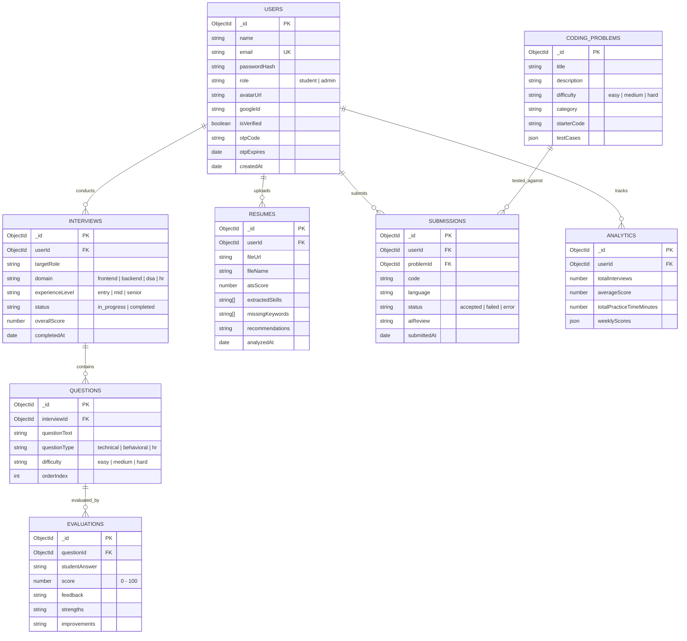

# InterviewVerse AI — Database Schema Design

## 1. Overview
InterviewVerse AI uses MongoDB as its primary datastore with Mongoose as the Object Data Modeling (ODM) layer.

---

## 2. Entity Relationship Model

